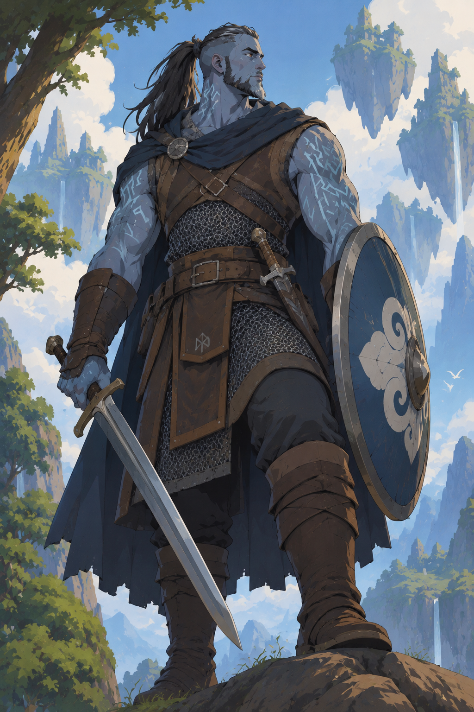

# Bromm Stormforged
- Class: Fighter
- Subclass: Rune Knight
- Race: Goliath (Cloud Giant)

Fighting Style: Dueling
Weapon Mastery:
  - Rapier/Shortsword (Vex)
  - Longsword (Sap)
  - Longbow (Slow) / Shortbow (Vex)

Quirks:
  - Homesick for the Sky - feel uncomfortable when you can't see the sky
  - Impeccable Manners - "Please" and 'Thank you". Compliment worthy opponents
  - Gear Etiquette - Everything is useful, everything has a purpose

Main Weapon
  - Sword and Shield (Short or longsword)

Items (Total: 155 GP):
| Item | Amount (GP) |
|-|-|
|Shortsowrd|10 GP|
|Longsword|15 GP|
|Shortbow|25 GP|
|Shield|10 GP|
|Chain Mail|75 GP|
|Explorer's Pack|10 GP|
|Extra Gold|10 GP|

## Description:
A towering Cloud Giant Goliath with blue-gray skin, a broad frame, and a powerful, athletic build. His black hair, streaked with gray, is long on top and tied into a thick ponytail, while the sides and back are shaved close.

Ancient giant runes cover his arms and shoulders, marking his heritage and connection to the old giant traditions.

He wears practical chain mail and sturdy leather armor, carrying a longsword, a shortsword, and a well-maintained shield. Every piece of equipment has its place and purpose, cared for with quiet, almost ceremonial attention.

His expression is calm and noble, his steady gaze reflecting patience and discipline. He believes that strength means little without responsibility, and that anything worth carrying deserves to be cared for.

## Feats
- Have
  - Dueling
- Wanted
  - Shield Master (Level 4)
  - Defense
  - Defensive Duelist
